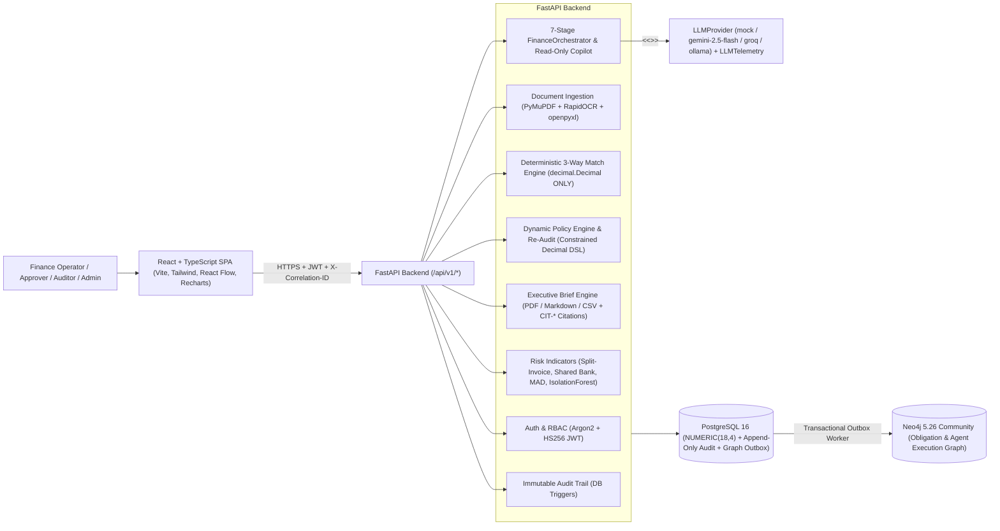
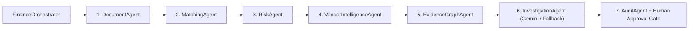
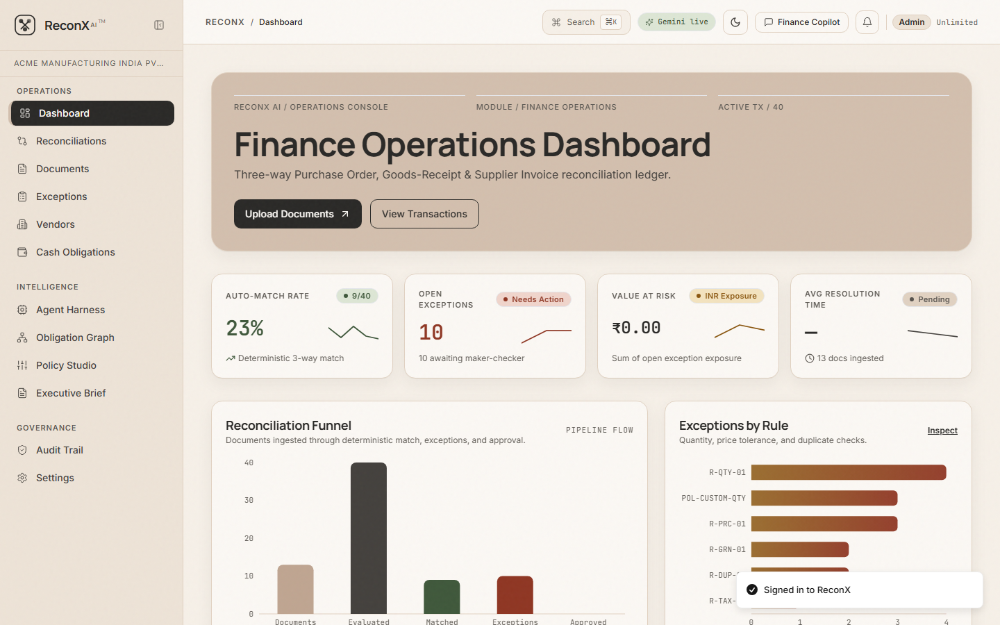
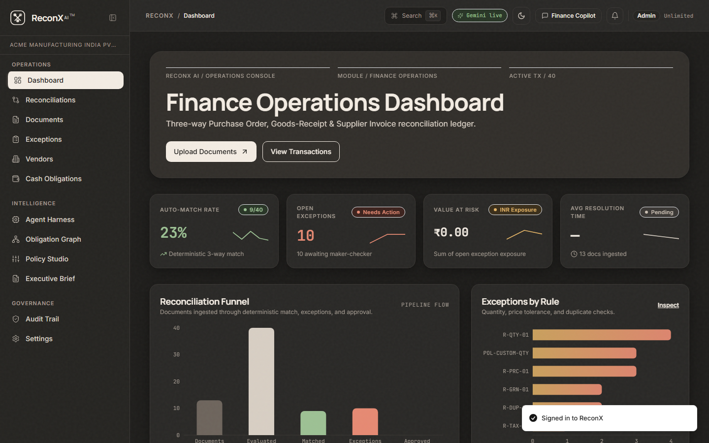
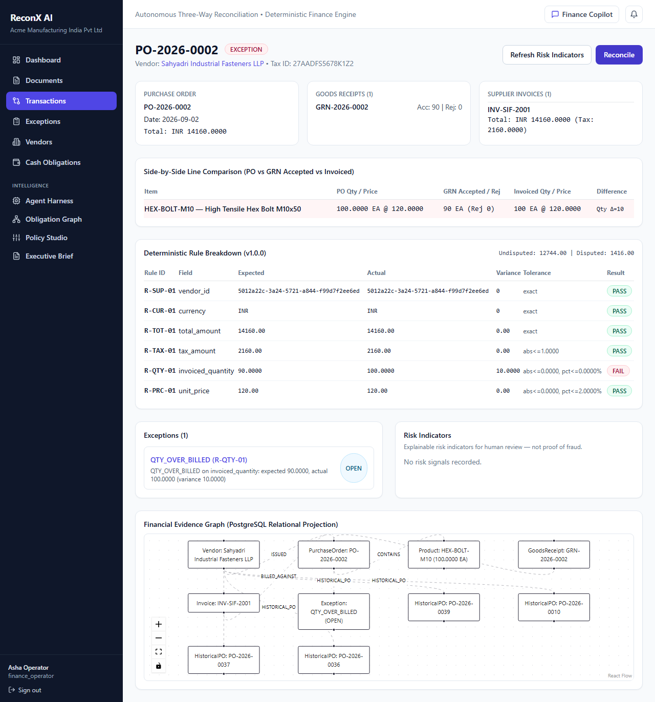
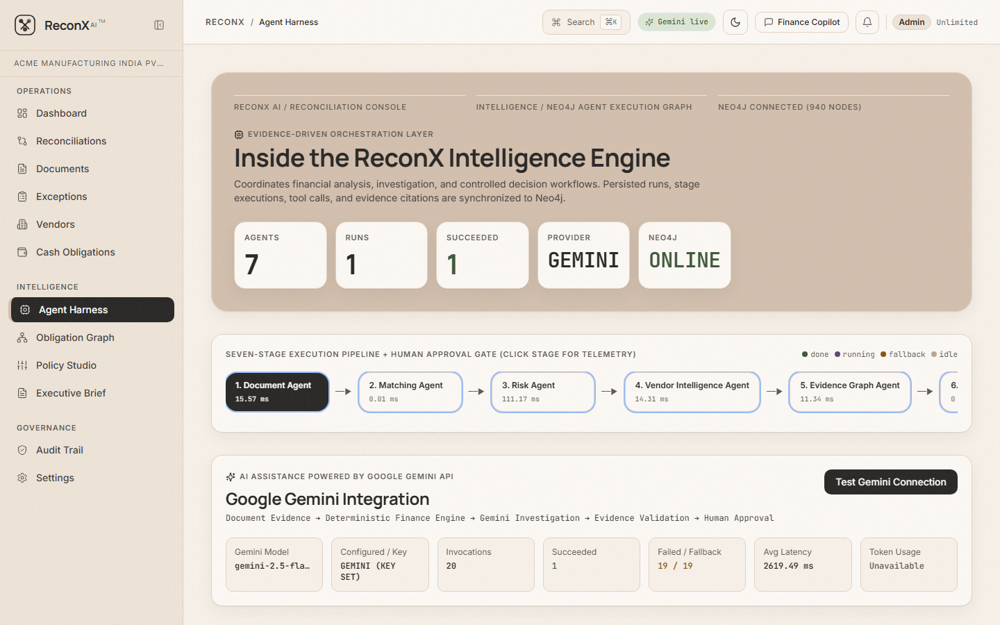
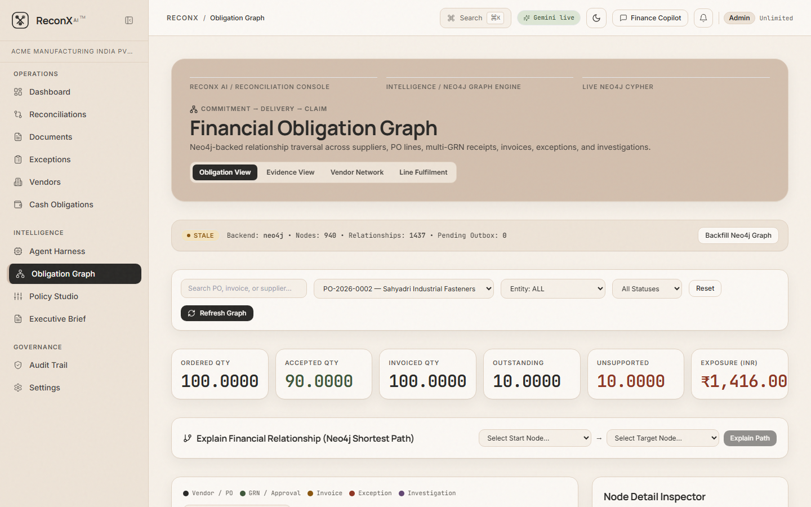
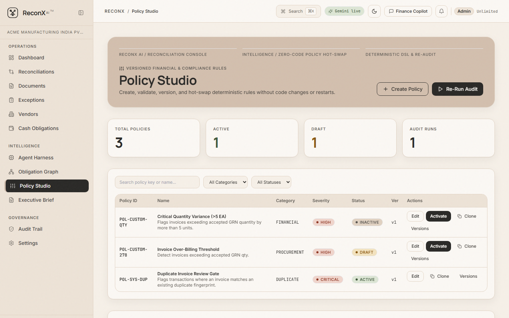
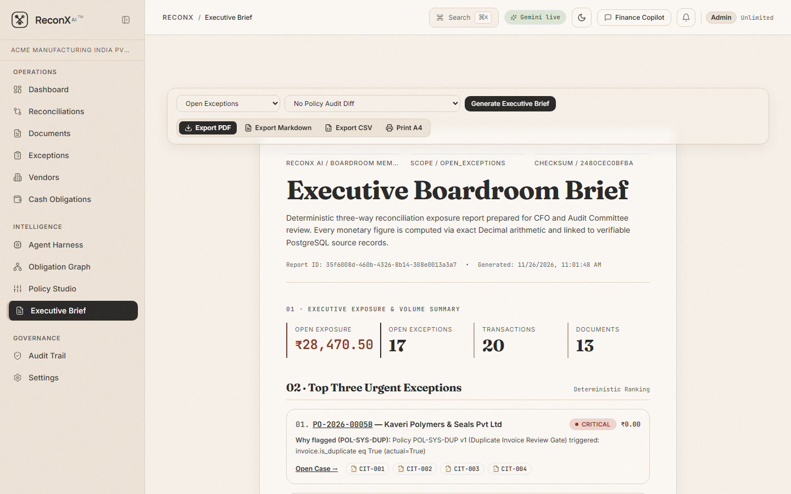

# ReconX AI — Autonomous Three-Way Invoice, PO & Goods-Receipt Reconciliation Bot

> **Synchronise 2026 (PS-BA1)** | Built to `docs/SRS.md` (`RXAI-SRS-001 v1.0`)

ReconX AI reconciles **Purchase Orders (PO)**, **Goods Receipt Notes (GRN)**, and **Supplier Invoices** using a pure deterministic `decimal.Decimal` matching engine, guarded document ingestion (`PyMuPDF` + `RapidOCR` + `openpyxl`), rule- and ML-based risk indicators, bounded AI investigations with DB-verified evidence citations, and strict RBAC + maker-checker approval workflows.

- **100% Free-Tier Stack**: FastAPI + PostgreSQL 16 + Neo4j 5.26 Community + React/TypeScript + Vite + Tailwind (Sandstone Ledger theme with self-hosted `@fontsource` typography and Radix UI primitives). Runs offline by default (`LLM_PROVIDER=mock`).
- **Deterministic Finance**: Zero `float` usage inside `backend/app/services/reconciliation/`. Every amount, tax calculation, tolerance, and quantity rollup uses `decimal.Decimal` (`ROUND_HALF_UP`). PostgreSQL remains the authoritative financial source of truth; Neo4j serves as the graph intelligence layer via a transactional outbox (`graph_outbox_event`).
- **Human Control**: AI never approves, matches, or pays. Risk outputs are surfaced strictly as *risk indicators, not proof of fraud*.

---

## Architecture & Key Documents



### 7-Stage Agent Harness (`FinanceOrchestrator`)



- [System Architecture](docs/architecture.md), [Agent Architecture](docs/agent-architecture.md) & [Neo4j Graph Architecture](docs/neo4j-architecture.md)
- [Neo4j Data Model](docs/neo4j-data-model.md), [Neo4j Setup](docs/neo4j-setup.md) & [Neo4j Demo Script](docs/neo4j-demo-script.md)
- [Software Requirements Specification](docs/SRS.md), [Decisions Log](docs/DECISIONS.md) & [Traceability Matrix](docs/requirements-traceability.md)
- [Dynamic Policy Engine](docs/policy-engine.md) & [Executive Boardroom Brief](docs/executive-brief.md)
- [API Reference](docs/api.md) & [API Contracts](docs/api-contracts.md)
- [Deployment Guide](docs/deployment.md) & [Docker + PostgreSQL Verification](docs/docker-postgresql-verification.md)
- [7-Minute Demo Script](docs/demo-script.md) & [Judge Q&A](docs/judge-qa.md)
- [Measured Evaluation Report](docs/evaluation-report.md) & [Benchmark Report](docs/benchmark-report.md)

---

## Screenshots

### Finance Operations Dashboard — Bento Grid (Light & Dark)



### Three-Way Match Detail & Financial Evidence Graph


### AI Agent Harness Explorer & Google Gemini Telemetry (`/agent-harness`)


### Financial Obligation Graph (`/obligation-graph`)


### Zero-Code Policy Studio & Re-Audit (`/policy-studio`)


### Executive Boardroom Brief with Verified Citations (`/executive-brief`)


---

## Quick Start

### Option A: One-Command Docker Compose
Requires Docker Desktop running on the host:
```bash
cp .env.example .env
docker compose up --build
```
- Backend runs `alembic upgrade head` automatically on startup at `http://localhost:8000` (Swagger docs: `http://localhost:8000/docs`).
- Frontend serves at `http://localhost:5173` (UI Kit showcase: `http://localhost:5173/dev/ui-kit`).
- Neo4j Browser serves at `http://localhost:7474` (Bolt: `bolt://localhost:7687`).
- To seed the demo dataset inside Docker:
  ```bash
  docker compose exec backend python scripts/seed.py --reset
  docker compose exec backend python scripts/make_sample_docs.py
  ```

### Option B: Local Bare-Metal Setup (SQLite, Offline-Safe)

1. **Copy environment template**:
   - Bash: `cp .env.example .env`
   - PowerShell: `Copy-Item .env.example .env`
2. **Backend setup & deterministic seed**:
   ```bash
   cd backend
   python -m venv .venv
   # Windows PowerShell: .venv\Scripts\Activate.ps1
   # macOS/Linux:        source .venv/bin/activate
   pip install -e ".[dev]"
   cd ..
   python scripts/reset_demo.py
   ```
   *(On macOS/Linux you can also run `bash scripts/reset_demo.sh`.)*
3. **Run Backend** (defaults to `DATABASE_URL=sqlite:///./reconx_demo.db` if set in `.env` or environment):
   ```powershell
   # Windows PowerShell
   $env:DATABASE_URL="sqlite:///./reconx_demo.db"
   cd backend; .\.venv\Scripts\python.exe -m uvicorn app.main:app --host 127.0.0.1 --port 8000
   ```
   ```bash
   # macOS / Linux
   cd backend && DATABASE_URL=sqlite:///./reconx_demo.db uvicorn app.main:app --host 127.0.0.1 --port 8000
   ```
4. **Run Frontend**:
   ```bash
   cd frontend
   npm install
   npm run dev
   ```
   Open `http://localhost:5173`.

---

## Demo Accounts & Acceptance Scenario Lookup

Password for all demo accounts: `ReconXDemo#2026!`

| Role | Email | Approval Limit | Purpose in Demo |
|---|---|---|---|
| Finance Operator | `operator@reconx-demo.com` | `0` (cannot approve) | Upload docs, fix fields, run reconciliation, blocked on `AT-09` |
| Approver | `approver@reconx-demo.com` | `500,000.00` INR | Review exceptions, approve/reject with rationale (`AT-12`) |
| Procurement | `procurement@reconx-demo.com` | `0` | Inspect POs and vendor history |
| Receiving | `receiving@reconx-demo.com` | `0` | Inspect GRN deliveries |
| Auditor | `auditor@reconx-demo.com` | `0` (read-only) | Inspect immutable `audit_event` trail & exports |
| Admin | `admin@reconx-demo.com` | `10,000,000.00` INR | Tolerance config, routing limits, job retries |

| Scenario | Seeded Record / Sample File | Expected Behaviour |
|---|---|---|
| `AT-01` Exact Match | `PO-2026-0001` / `sample_data/*_at01.pdf` | Clean 3-way match (`MATCHED`) |
| `AT-02` Over-Billing | `PO-2026-0002` (`GRN 90` vs `INV 100`) | Flags `10 EA` variance (`R-QTY-01`) & opens exception |
| `AT-03` Multi-GRN Split | `PO-2026-0003` (`60 + 40`) / `sample_grn_at03.xlsx` | Aggregates both GRNs without double-counting (`MATCHED`) |
| `AT-04` Price Variance | `PO-2026-0004` (`100.00` vs `112.00`) | Flags unit-price variance outside tolerance |
| `AT-05` Duplicate Invoice | `PO-2026-0005` & `PO-2026-0005B` (`INV-KPS-4001`) | Normalized duplicate flagged as review risk indicator |
| `AT-07` Low Confidence | `sample_data/sample_scanned_invoice_at07.png` | Scanned PNG (`[BLURRED STAMP]`) queued for human field edit |
| `AT-08` Prompt Injection | `sample_data/sample_injection_invoice_at08.pdf` | Injection ignored; fenced as untrusted evidence |
| `AT-09` & `AT-12` Governance | Exception workflow decisions | Operator receives `403`; Approver needs rationale + maker-checker |

---

## Environment Variables & Switching `LLM_PROVIDER`

All environment variables are documented with safe non-secret defaults in [`.env.example`](.env.example) and [docs/deployment.md](docs/deployment.md). Key settings:

- `DATABASE_URL`: PostgreSQL (`postgresql+psycopg://...`) or SQLite (`sqlite:///./reconx_demo.db`)
- `JWT_SECRET`: Secret signing key (minimum 32 characters in production)
- `CORS_ORIGINS`: Comma-separated allowed origins (e.g. `http://localhost:5173`)
- `VITE_API_BASE_URL`: Backend URL **without** `/api/v1` suffix (default `http://localhost:8000`)
- `FEATURE_EVIDENCE_GRAPH`, `FEATURE_FINANCE_COPILOT`, `FEATURE_ANOMALY_ML`, `FEATURE_CASH_VIEW`, `FEATURE_REPORT_EXPORTS`: `true`/`false` feature flags

**Switching AI Provider** (demo defaults to offline `mock`):
- **Offline Mock (default)**: `LLM_PROVIDER=mock`
- **Google Gemini (free key)**: `LLM_PROVIDER=gemini`, `GEMINI_API_KEY=<key>`
- **Groq (free key)**: `LLM_PROVIDER=groq`, `GROQ_API_KEY=<key>`
- **Ollama (local)**: run `ollama pull llama3.2`, set `LLM_PROVIDER=ollama`

---

## Google Gemini API Integration

AI assistance in ReconX AI is **powered by the Google Gemini API** (`gemini-2.5-flash` via `LLM_PROVIDER=gemini` and `GEMINI_API_KEY`, kept strictly backend-only).
- **Exact Operations Using Gemini:** `InvestigationAgent` (`LLMProvider.explain` for natural-language discrepancy summaries over DB-verified facts) and optional document classification/extraction fallback (`LLMProvider.classify` / `extract`) in [adapter.py](backend/app/services/llm/adapter.py).
- **Security & Determinism:** All document text is fenced in `<<<UNTRUSTED_DOCUMENT_CONTENT>>>`, `decimal.Decimal` 3-way matching never calls Gemini, and `validate_evidence_refs` rejects any unresolvable citation.
- **Fallback & Telemetry:** If Gemini is unconfigured (`mock` default), times out, or hits rate/auth errors, ReconX degrades gracefully to deterministic local templates and records `fallback_used=true` + `actual_provider="mock"` in `llm_telemetry` (never mislabeling fallback output as Gemini-generated).

---

## Testing & Verification Commands

```bash
# Backend unit, acceptance (AT-01..AT-12), security & resilience suite
cd backend && pytest -v

# Backend static checks
cd backend && ruff check . && mypy app

# Frontend lint, unit tests, production build & Playwright E2E
cd frontend && npm run lint && npm test && npm run build

# Regenerate measured evaluation report
cd backend && python scripts/run_evaluation.py
```

---

## Troubleshooting

- **Docker daemon not running**: If `docker compose up` fails to connect to the Docker engine pipe/socket, start Docker Desktop or run **Option B (Local Bare-Metal SQLite)** above.
- **CORS or 404 `/api/v1/api/v1/...` errors in frontend**: Ensure `VITE_API_BASE_URL` is set to `http://localhost:8000` (or `https://your-backend.onrender.com`) **without** a trailing `/api/v1`, and verify `CORS_ORIGINS` matches your exact frontend origin.
- **Database locked / stale demo state**: Stop the backend server and re-run `python scripts/reset_demo.py` (or `bash scripts/reset_demo.sh`).
- **PowerShell command chaining**: Windows PowerShell 5.1 does not support `&&`; use `;` or separate lines between commands.
