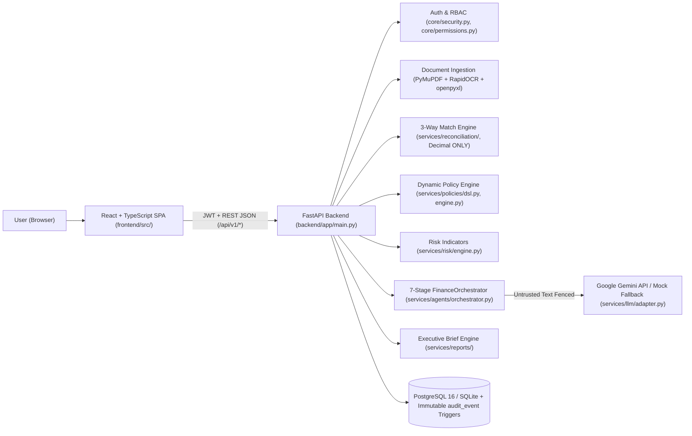

# ReconX AI — Beginner Master Guide (From Zero to Expert)

> **Project:** ReconX AI (Synchronise 2026 — PS-BA1)  
> **Repository:** `https://github.com/aadi-learner77/ReconX` (synced on `main`)  
> **Core Idea:** ReconX AI checks supplier bills against what a company ordered and what the warehouse actually received—using exact math for money, and Google Gemini only to help explain discrepancies to humans.

---

## 1. The Business Problem from Zero

### 1.1 What is Accounts Payable (AP)?
When a company buys raw materials or parts from a supplier (vendor), the **Accounts Payable (AP)** team is responsible for paying the supplier's bill (**Invoice**).  
If the company blindly pays every bill that arrives in its inbox, it loses money when suppliers accidentally (or deliberately) bill for:
- More items than were ordered
- Damaged or rejected items that the warehouse never accepted
- Higher prices than agreed
- The same bill submitted twice (**Duplicate Invoice**)

### 1.2 The Three Important Documents (With an Indian Rupee Example)
1. **Purchase Order (PO):** Created by the buyer's Procurement team. Says *"We want to buy 100 High Tensile Hex Bolts at ₹120.00 each (Total ₹14,160.00 including 18% GST)."*
2. **Goods Receipt Note (GRN):** Created by the warehouse Receiving team when the truck arrives. Says *"We received 90 bolts and accepted 90 bolts (10 were short/missing)."* Sometimes a supplier delivers in two trucks—creating **GRN 1 (60 units)** and **GRN 2 (40 units)**.
3. **Supplier Invoice:** Sent by the supplier asking for money. Says *"Please pay me for 100 bolts at ₹120.00 each = ₹14,160.00."*

### 1.3 What is Three-Way Matching? (Real Seeded Scenario `AT-02`)
**Three-way matching** compares **PO ↔ GRN ↔ Invoice** line by line:

| Document | Record in ReconX | Quantity | Unit Price | Status |
|---|---|---|---|---|
| **Purchase Order** | `PO-2026-0002` | `100 EA` | ₹120.00 | Ordered |
| **Goods Receipt** | `GRN-2026-0002` | `90 EA` accepted | — | Short receipt |
| **Supplier Invoice** | `INV-SIF-2001` | `100 EA` billed | ₹120.00 | **Over-billed by 10 EA (₹1,200.00)** |

**60-Second Explanation:**  
*"In finance, companies lose money when they pay supplier invoices without checking if the goods actually arrived at the warehouse. ReconX AI automates three-way matching between Purchase Orders, Goods Receipt Notes, and Invoices using 100% deterministic `Decimal` math—never floating-point guesses. When a mismatch happens, a 7-stage AI Agent Harness powered by Google Gemini gathers evidence from our PostgreSQL database, explains why it happened, and routes it to a human approver with an immutable audit trail."*

---

## 2. Full System Architecture

**What happens when you click a button (e.g., "Reconcile" on `PO-2026-0002`):**
1. **React (`TransactionDetailPage.tsx`)** calls `api.reconcileTransaction(id)` in `frontend/src/api/client.ts`.
2. **FastAPI (`api/v1/reconciliation.py`)** checks your JWT token and `reconciliation:run` permission, and scopes the query to your `organization_id`.
3. **`reconciliation_adapter.py`** loads the PO, GRNs, Invoices, and `ToleranceConfig` from PostgreSQL, converts them to pure `decimal.Decimal` inputs, and calls `reconcile_transaction(...)`.
4. **Dynamic Policy Engine (`services/policies/engine.py`)** evaluates any `ACTIVE` custom policies from the database.
5. **Database** saves the `ReconciliationRun`, `MatchResult`s, any `ExceptionCase`s, and an append-only `AuditEvent`.
6. **React Query** automatically refreshes the screen so you immediately see `EXCEPTION` and `R-QTY-01`.

---

## 3. Technologies Used (Plain-English Map)

| Category | Technology | What It Does in ReconX | Exact Code Location |
|---|---|---|---|
| **Frontend** | React + TypeScript + Vite | Builds the fast, type-safe web UI | `frontend/src/App.tsx` |
| **Styling** | Tailwind CSS + Lucide Icons | Clean fintech cards, tables, and icons | `frontend/src/components/Layout.tsx` |
| **State / Routing** | TanStack React Query + React Router | Caching API calls & page navigation | `frontend/src/api/client.ts` |
| **Graphs / Charts** | React Flow + Recharts | Interactive Evidence/Obligation Graphs & KPI bars | `frontend/src/pages/ObligationGraphPage.tsx` |
| **Backend** | Python 3.11 + FastAPI + Pydantic | REST API server + strict input validation | `backend/app/main.py` |
| **Database & ORM** | PostgreSQL 16 / SQLite + SQLAlchemy + Alembic | Stores financial tables + schema migrations | `backend/app/models/`, `backend/migrations/` |
| **Document Parsing** | PyMuPDF + RapidOCR + openpyxl | Reads PDF text, scans PNGs, parses Excel/CSV | `backend/app/services/documents/` |
| **AI & ML** | Google Gemini (`gemini-2.5-flash`) + scikit-learn `IsolationForest` | Explains discrepancies & flags statistical outliers | `backend/app/services/llm/adapter.py`, `risk/engine.py` |
| **Testing & Lint** | pytest, Hypothesis, Ruff, Mypy, Vitest, Playwright | Automated math, security, API, and browser tests | `backend/tests/`, `frontend/e2e/` |
| **Infrastructure** | Docker + Docker Compose | Runs Postgres + Backend + Frontend in one command | `docker-compose.yml` |

---

## 4. Deterministic Reconciliation & `decimal.Decimal`
- **Why `decimal.Decimal` instead of `float`?** In Python, `0.1 + 0.2 == 0.30000000000000004` (`float` binary rounding error). For money and taxes, ReconX uses `decimal.Decimal` (`ROUND_HALF_UP`) and PostgreSQL `NUMERIC(18,4)`.
- **Why never let an LLM do financial math?** LLMs predict text tokens—they can hallucinate numbers. In ReconX, `backend/app/services/reconciliation/` has **zero** LLM, HTTP, or `float` imports (enforced by automated AST tests in `test_hardening_security.py`).
- **Implemented Scenarios (`AT-01`..`AT-12`):**
  - `AT-01`: Exact match (`PO-2026-0001` → `MATCHED`)
  - `AT-02`: Over-billing (`PO-2026-0002`, GRN 90 vs INV 100 → `EXCEPTION` under `R-QTY-01`)
  - `AT-03`: Multi-GRN split delivery (`PO-2026-0003`, `60 + 40 = 100` → `MATCHED`, zero double-counting)
  - `AT-04`: Price variance (`100.00` vs `112.00` → `R-PRC-01` `EXCEPTION`)
  - `AT-05`: Duplicate invoice (`INV-KPS-4001` → `R-DUP-01` + Risk Signal)
  - `AT-06`: Missing PO (`INCOMPLETE`)
  - `AT-07`: Low-confidence scanned PNG (`sample_scanned_invoice_at07.png` → `NEEDS_REVIEW`)
  - `AT-08`: Prompt injection PDF (`sample_injection_invoice_at08.pdf` → ignored & fenced)
  - `AT-09` & `AT-12`: RBAC (`operator` blocked `403`, `approver` decides with rationale)
  - `AT-10`: Relational graph works via PostgreSQL without Neo4j
  - `AT-11`: Copilot tenant isolation

---

## 5. Seven-Stage AI Agent Harness (`FinanceOrchestrator`)
Located in `backend/app/services/agents/orchestrator.py` and `investigator.py`:
1. **Document Agent (`DocumentAgent`):** Loads transaction bundle & checks linked documents (`NEEDS_REVIEW`).
2. **Matching Agent (`MatchingAgent`):** Inspects 3-way completeness (PO, GRNs, Invoices) & missing records.
3. **Risk Agent (`RiskAgent`):** Runs duplicate, split-invoice, MAD price-spike, shared-bank, and `IsolationForest` checks.
4. **Vendor Intelligence Agent (`VendorIntelligenceAgent`):** Loads vendor mismatch rate, delivery lead days, and small-sample guard (`N < 5`).
5. **Evidence Graph Agent (`EvidenceGraphAgent`):** Traverses historical vendor POs and cross-document relationships.
6. **Investigation Agent (`InvestigationAgent`):** Calls `LLMProvider.explain()` (Google Gemini when configured) with untrusted text fenced in `<<<UNTRUSTED_DOCUMENT_CONTENT>>>`, then validates every cited ID in `validate_evidence_refs()` (rejects fabricated UUIDs with `422`).
7. **Audit Agent (`AuditAgent`):** Records `tool_trace`, `execution_trace`, `LLMTelemetry`, and persists `DRAFT_READY` with `human_approval_required=True`.

**Allowlisted Tools (`tools.py`):** `get_transaction_bundle`, `search_related_documents`, `get_vendor_history`, `run_reconciliation`, `create_investigation_draft`, `assign_case`, `request_clarification`. **There is NO payment tool, NO approval tool, and NO raw SQL tool.**

---

## 6. Google Gemini Integration (`backend/app/services/llm/adapter.py`)
- **How it works:** `get_llm_provider()` reads `LLM_PROVIDER` (`mock` | `gemini` | `groq` | `ollama`). When `gemini` is set, `GeminiLLMProvider` calls `generativelanguage.googleapis.com/v1beta/models/{GEMINI_MODEL}:generateContent` (currently `gemini-2.5-flash`) with `temperature=0.0` and `responseMimeType="application/json"`.
- **Observability (`llm_telemetry` table):** Every call records `configured_provider`, `actual_provider`, `model_id`, `operation_name`, `success`, `fallback_used`, `latency_ms`, and `error_category` (`MISSING_API_KEY`, `AUTH_ERROR`, `RATE_LIMITED`, `TIMEOUT`, `MODEL_UNAVAILABLE`). API keys never leave the backend.
- **Honest Attribution:** If Gemini fails or times out, ReconX falls back to `mock` and labels the investigation `"Mock fallback used — not Gemini-generated."` Only real Gemini responses show `"Generated with Google Gemini"`.

---

## 7. Donut Challenge 1 — Zero-Code Policy Hot-Swap & Re-Audit (`/policy-studio`)
- **Constrained DSL (`services/policies/dsl.py`):** Admins build rules using allowlisted fields (`variance.qty_diff`, `invoice.total_amount`, etc.) and operators (`gt`, `gte`, `eq`, `between`, etc.) with `Decimal` math—never `eval()` or raw SQL.
- **Immutable Versioning (`Policy` + `PolicyVersion`):** Activating a policy creates a SHA-256-hashed immutable version and takes effect immediately without restarting FastAPI.
- **Dry-Run Preview (`POST /policies/preview`):** Shows how many historical transactions would match *before* activating.
- **Re-Run Audit (`POST /policy-audits`):** Scans org transactions, creates idempotent exceptions (`Newly Flagged`), avoids duplicating existing open exceptions (`Existing Violations`), and tracks cleared rules (`No Longer Triggered`).

---

## 8. Donut Challenge 2 — Executive Boardroom Brief (`/executive-brief`)
- **Service (`services/reports/executive_brief.py` & `renderers.py`):**
  - Aggregates real KPIs (`Documents`, `Transactions`, `Open Exceptions`).
  - Computes `Decimal` financial exposure deduplicated per transaction (e.g. `AT-02`: `10 EA × ₹120.00 = ₹1,200.00`).
  - Ranks **Top 3 Urgent Exceptions** deterministically (`Severity` → `Exposure` → `Oldest` → `ID`).
  - Resolves and verifies **`CIT-001`..`CIT-*`** citations directly against PostgreSQL rows.
  - Exports formatted **PDF** (ReportLab), **Markdown**, and formula-injection-safe **CSV**, storing an immutable snapshot checksum.

---

## 9. Security, Database & Code Map
- **Security:** Argon2 password hashing, HS256 JWT, 6-role RBAC (`permissions.py`), tenant isolation via `OrgScopedRepository(organization_id)`, maker-checker self-approval block, DB triggers preventing `UPDATE`/`DELETE` on `audit_event`.
- **Key Files to Know:**
  - Backend entry: `backend/app/main.py`, `backend/app/api/v1/router.py`
  - Core math: `backend/app/services/reconciliation/engine.py`, `rules.py`, `money.py`
  - Agents & Gemini: `backend/app/services/agents/orchestrator.py`, `investigator.py`, `backend/app/services/llm/adapter.py`
  - Policies & Briefs: `backend/app/services/policies/engine.py`, `backend/app/services/reports/executive_brief.py`
  - Frontend shell & pages: `frontend/src/App.tsx`, `frontend/src/components/Layout.tsx`, `frontend/src/api/client.ts`
