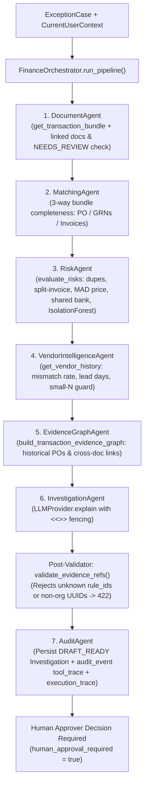
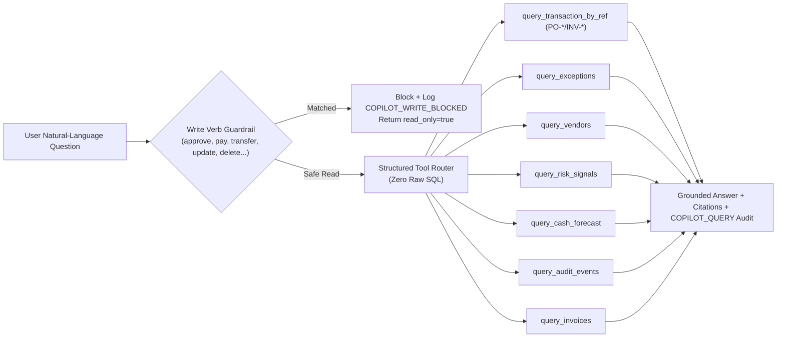

# ReconX AI — Agent Architecture

ReconX AI uses a **deterministic Python DAG orchestrator** (`FinanceOrchestrator` in `backend/app/services/agents/orchestrator.py`) instead of an unconstrained autonomous loop (Decision `D10`). Every agent step operates through an **allowlisted, tenant-scoped, audited `AgentToolbox`** (`backend/app/services/agents/tools.py`).

## 1. Multi-Agent Investigation Pipeline (`POST /api/v1/exceptions/{id}/investigations`)

## 2. Read-Only Finance Copilot (`POST /api/v1/copilot/query`)

## 3. Safety & Grounding Invariants
- **Interactive Explorer UI:** Exposed in the frontend at `/agent-harness` (`AgentHarnessPage.tsx`), backed by `GET /api/v1/intelligence/agent-harness`.
- **No payment or approval tools** exist in `ALLOWLISTED_AGENT_TOOLS` (`tools.py`).
- **Prompt injection defense**: Untrusted document/case text is wrapped in `<<<UNTRUSTED_DOCUMENT_CONTENT>>>` markers (`llm/adapter.py`).
- **Zero fabricated citations**: `validate_evidence_refs` (`investigator.py`) verifies every cited UUID against `OrgScopedRepository` before persistence.
- **Provider fallback**: If `gemini`, `groq`, or `ollama` fails or times out, `_HTTPJsonLLMProvider` falls back cleanly without breaking deterministic matching or investigation persistence.
