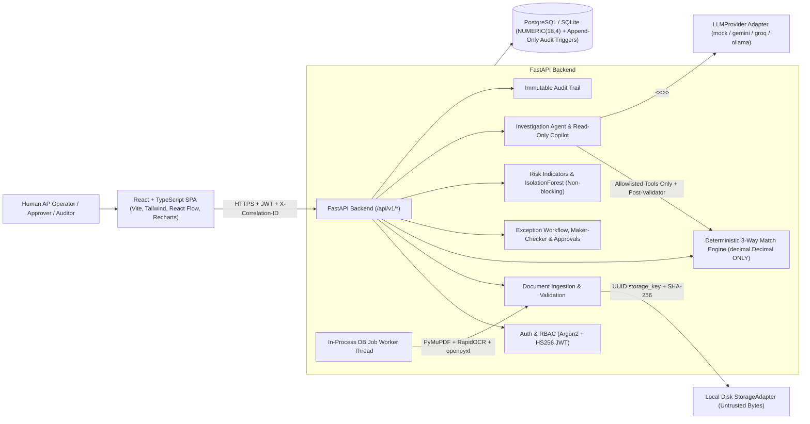

# ReconX AI — System Architecture

ReconX AI uses the **simplest viable single-backend, single-frontend, single-database** architecture (`RXAI-SRS-001 v1.0`) designed for deterministic financial correctness and strict prompt-injection resilience.

## 1. High-Level Component Diagram

## 2. Trust Boundaries & Financial Guarantees

1. **Deterministic Finance Boundary (`app/services/reconciliation/`)**:
   - Contains **zero** SQLAlchemy, FastAPI, HTTP, LLM, or `float` usage (enforced by AST tests in `test_hardening_security.py`).
   - All money, quantity, tax, and tolerance arithmetic uses `decimal.Decimal` (`ROUND_HALF_UP`) and database `NUMERIC(18,4)`.
2. **Untrusted Data Boundary (`app/services/documents/` & `app/services/llm/`)**:
   - Uploaded PDFs, PNG/JPEGs, XLSX/CSVs, OCR text, and email strings are treated strictly as inert evidence, wrapped in `<<<UNTRUSTED_DOCUMENT_CONTENT>>>` markers.
   - Investigation agent outputs require `human_approval_required = True`, pass strict Pydantic schema validation, and undergo DB-resolvable `evidence_ref` post-validation before persistence.
3. **Authorization & Tenant Isolation (`app/core/permissions.py` & `OrgScopedRepository`)**:
   - Server-side RBAC maps roles (`finance_operator`, `approver`, `procurement`, `receiving`, `auditor`, `admin`) to fine-grained permissions.
   - Every repository query filters by `organization_id` from the verified JWT claim; cross-tenant detail probes return `404` or `403`.
   - Maker-checker rule prevents a user from approving an exception they raised/created.
4. **Immutable Auditability (`audit_event`)**:
   - Database triggers (`0001_foundation.py` + `ensure_sqlite_audit_triggers`) block `UPDATE` and `DELETE` on `audit_event` rows.
