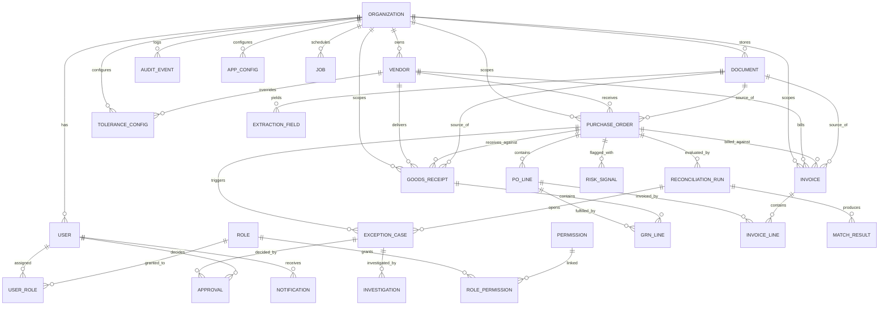

# Entity-Relationship Diagram — ReconX AI

Every business table uses UUID primary keys, `organization_id` tenant scoping, UTC timestamps, and `NUMERIC(18, 4)` for monetary amounts and quantities.

## Key Data Integrity Rules (SRS 8.3)
- **Unique invoice constraint**: `UNIQUE (organization_id, vendor_id, normalized_invoice_number)` on `invoice` (plus duplicate-handling metadata when an attempted duplicate is flagged for review).
- **Immutable audit trail**: PostgreSQL trigger raises an exception on `UPDATE` or `DELETE` on `audit_event`.
- **Money precision**: `NUMERIC(18, 4)` paired with explicit `currency` ISO-4217 column; zero float columns for currency or quantity.
- **Extraction provenance**: `extraction_field.verification_status` enum (`extracted`, `user_corrected`, `system_derived`) + `version` integer.
- **Optimistic locking**: `exception_case.version` integer prevents stale approval overwrites (`409 Conflict`).
